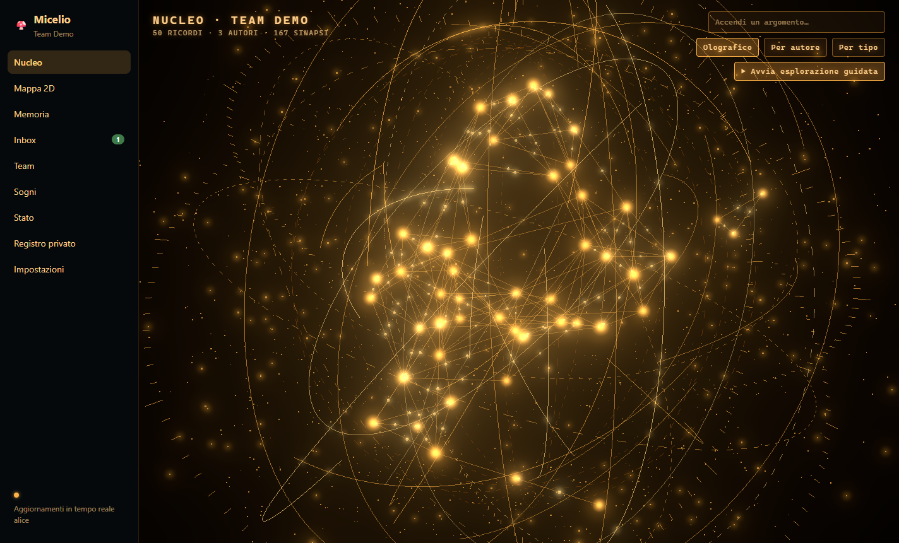
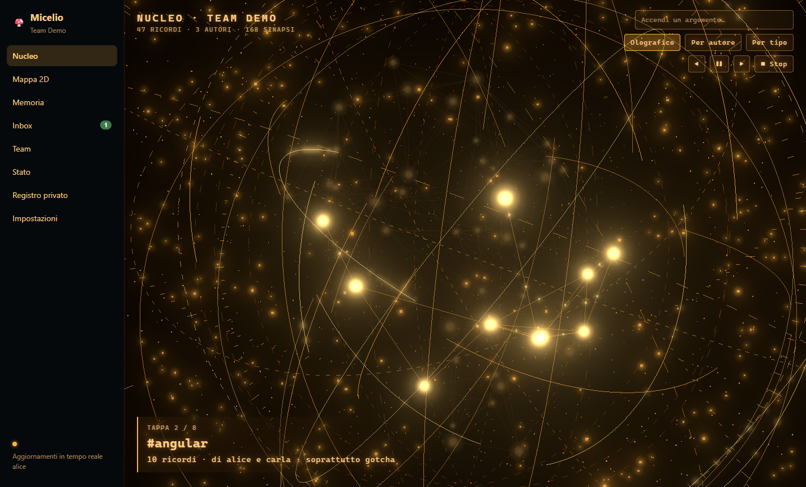
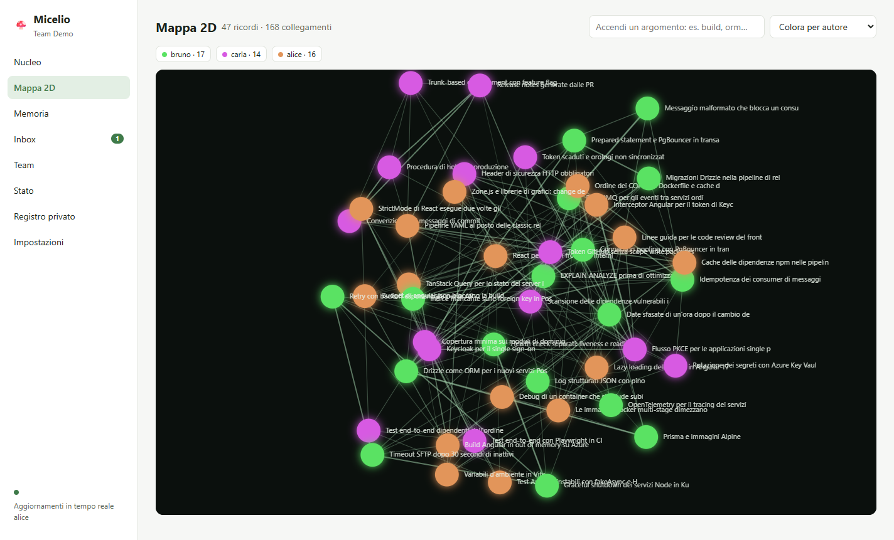
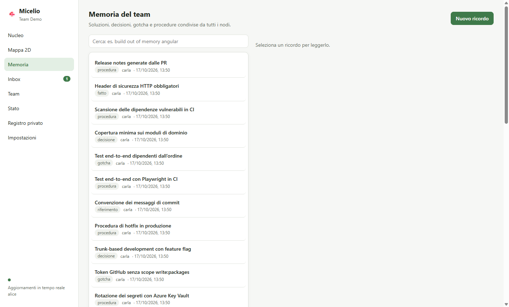
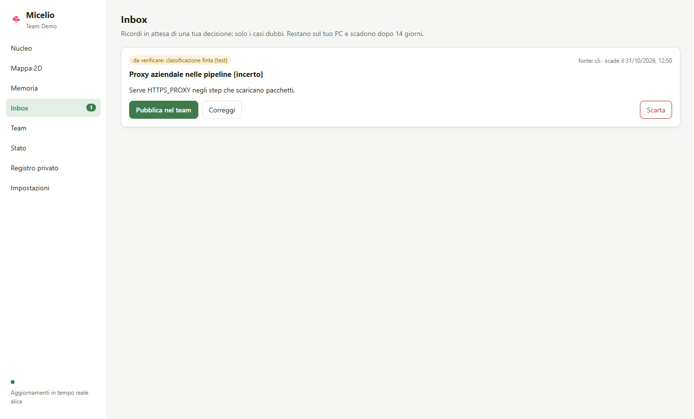
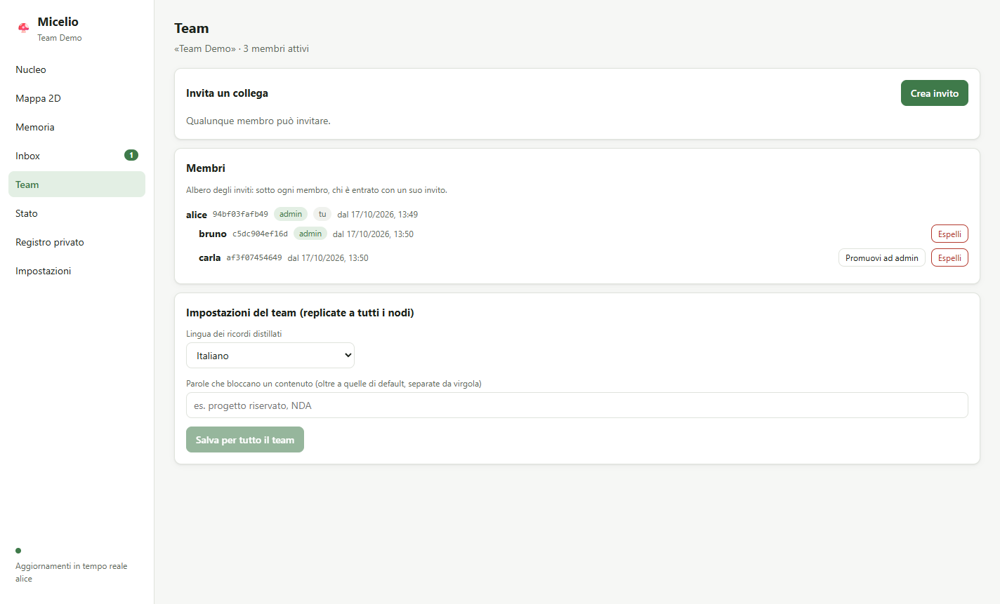
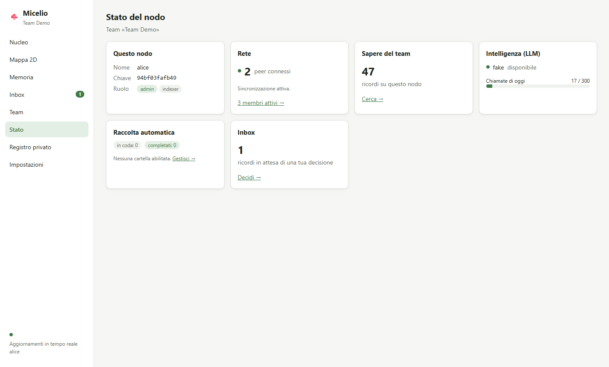
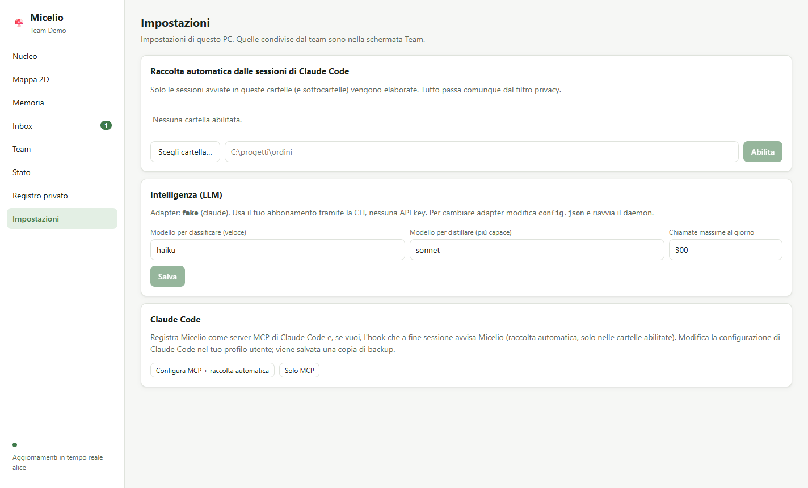

# App desktop e interfaccia

L'interfaccia di Micelio è una web app **React** servita dal daemon. Si usa in due modi:

- **App desktop** (consigliata): `npm run desktop`. Avvia da sola il daemon, mostra notifiche e resta nell'area di notifica.
- **Browser**: `micelio ui` apre l'interfaccia con un link monouso, valido 60 secondi.

Per ora non ci sono installer: l'app si avvia da console, dalla cartella del progetto (vedi il piano, Fase 7).

```bash
npm run build      # daemon + UI
npm run desktop    # app desktop (avvia il daemon se serve)
```

Se l'app si chiude subito all'avvio dal terminale di VS Code, la causa è la variabile `ELECTRON_RUN_AS_NODE`, impostata da VS Code. `npm run desktop` passa da `desktop/launch.js`, che la rimuove; non lanciare `electron` direttamente.

## Prova senza toccare il tuo nodo

```bash
npm run build && npm run demo                     # 3 nodi locali (alice, bruno, carla) con ~50 ricordi inventati
MICELIO_HOME=.demo/alice npm run desktop          # in un altro terminale (PowerShell: $env:MICELIO_HOME=".demo/alice"; npm run desktop)
```

Il team demo usa una DHT privata e un LLM finto: niente esce su internet e non consuma l'abbonamento. Si ferma con Ctrl+C. I dati restano in `.demo/` (ignorata da git).

## Le schermate

### Nucleo (home)



Il sapere del team come un **ologramma 3D**.
- **Ricordi e sinapsi:** ogni punto luminoso è un ricordo; le linee sono le *sinapsi*, cioè i collegamenti fra ricordi correlati, percorse da impulsi di luce.
- **Correlazioni oggi e domani:** oggi i ricordi sono correlati quando hanno tag in comune, pesati per rarità. Dalla Fase 5 si aggiungerà l'affinità di significato, dalla Fase 6 i legami creati dal dreaming.

**Navigazione libera:**
- trascina per ruotare, rotella per lo zoom;
- clic su un ricordo per volarci e leggerlo nel pannello laterale;
- dopo 20 secondi senza interazioni la sfera torna a ruotare da sola.

**Esplorazione guidata** ("▶ Avvia esplorazione guidata"): la camera vola da un argomento all'altro, con una didascalia che riporta quanti ricordi ci sono, chi li ha scritti e il tipo prevalente. Si può andare avanti, indietro, mettere in pausa e fermarsi.



**Ricerca** ("Accendi un argomento…"): i ricordi pertinenti si accendono, gli altri si attenuano, e la camera vola su di loro.

**Colori:** *Olografico* (ambra, più chiaro per i ricordi più collegati), *Per autore* (ogni collega ha un colore stabile) o *Per tipo*.

Parametri dall'indirizzo, utili su PC con grafica debole o per prove:

| Parametro | Effetto |
|---|---|
| `#/?bloom=0` | Disattiva il bagliore |
| `#/?tour=1` | Avvia subito l'esplorazione guidata |
| `#/?bs=1.35&br=0.4&bt=0.22` | Forza, raggio e soglia del bagliore |

### Mappa 2D



Vista bidimensionale per **analisi mirate**:
- colori per autore o per tipo;
- clic su una voce della legenda per isolare un autore o un tipo;
- ricerca che accende i ricordi pertinenti;
- le etichette compaiono avvicinandosi con lo zoom.

### Memoria



Ricerca full-text, ultimi ricordi arrivati, dettaglio con autore e data. "Nuovo ricordo" propone un ricordo al team; passa dal filtro privacy come da CLI e da Claude.

### Radici

Il sapere fondante del team, per categoria: architettura, rete, interfacce, dominio, best practice, policy.
- Filtro per progetto e per testo.
- Le Radici **da rivedere** sono in evidenza, con i motivi.
- **Rivedi le Radici** lancia la revisione e mostra il resoconto.
- **Suggerite da Micelio:** proposte del distillatore, da promuovere (scegliendo la categoria) o ignorare.
- Nel dettaglio di un ricordo: *Rendi Radice*, *Rivista: è ancora valida*, *Cambia categoria*, *Non è più una Radice*.

Nel **Nucleo** le Radici sono al centro della sfera con un anello bianco (rosso se da rivedere). Nella **Mappa 2D** sono rombi con contorno. In entrambe le viste **◆ Radici** isola solo le Radici.

### Inbox



Solo i casi dubbi: per ognuno il motivo e la scadenza. Le azioni sono *Pubblica nel team*, *Correggi* (modifica titolo e corpo, per esempio per togliere un dettaglio sensibile, poi pubblica) e *Scarta*. Il numero in barra laterale indica quanti elementi aspettano.

### Team



- **Inviti:** crea un invito e copialo, con l'avviso se nessun altro membro l'ha ancora ricevuto.
- **Membri:** albero degli inviti.
- **Solo per gli admin:** promozione, espulsione con conferma e impostazioni condivise (lingua dei ricordi, parole chiave del filtro).

### Stato



Il nodo a colpo d'occhio: ruolo, peer connessi, ricordi, LLM e budget di oggi, coda della raccolta automatica, inbox.

**Spazio occupato** mostra:
- il totale su questo disco, diviso per componente;
- la quota del log del team che viene da ciascun membro, con una barra a segmenti e una tabella. I colori dei membri sono gli stessi del Nucleo e della Mappa.

### Sicurezza

- **Banco di prova:** testo o nome di file, e cosa toglierebbe il filtro.
- **Regole:**
  - quelle fisse: 25 tipi di segreto e dato personale, 33 regole sui file sensibili;
  - quelle del team: pattern, eccezioni, file sensibili, modificabili solo dall'admin.
- **Ricordi da ripulire:** scansione dei ricordi pubblicati e *Ripulisci* (admin, con conferma).
- **Registro di questo PC:** cosa è stato tolto e da dove, senza valori.

### Registro privato e Impostazioni

- **Registro privato:** cosa non è andato al team e perché.
- **Impostazioni:**
  - **Rete:** DHT pubblica o DHT privata del team, con i nodi di avvio. *Verifica* prova la scelta senza applicarla; *Applica* chiede conferma e ricollega subito il nodo;
  - cartelle abilitate alla raccolta automatica (nell'app c'è il selettore di cartelle);
  - modelli e budget LLM, con effetto immediato;
  - configurazione di Claude Code (MCP + hook), con conferma, perché modifica il tuo profilo.



## Aggiornamenti in tempo reale

Tutte le schermate si aggiornano da sole: il daemon invia un evento a ogni cambiamento (`GET /api/events`) e la UI ricarica solo i dati interessati. Il pallino in basso nella barra laterale indica se il collegamento è attivo.

## Notifiche (app desktop)

L'app resta nell'area di notifica anche con la finestra chiusa. "Esci" dal menu dell'icona la chiude; il nodo resta attivo. Avvisa quando:

- arrivano nuovi ricordi in inbox;
- il nodo è isolato da più di 10 minuti (nessun collega raggiungibile);
- il budget LLM del giorno supera il 90%.

Un clic sulla notifica apre la schermata giusta.

## Sicurezza

- La UI nell'app gira isolata (`contextIsolation`, `sandbox`, niente Node). Riceve dal preload solo il token e il selettore di cartelle.
- Navigazione consentita solo verso la UI locale; i link esterni si aprono nel browser di sistema.
- I testi dei ricordi arrivano da altri nodi: il Markdown è reso **senza** HTML grezzo, e nei tooltip del grafo i titoli sono sempre "neutralizzati". Un nodo malevolo non può eseguire script nella tua UI.
- Nel browser il token non compare mai nell'URL: il link di `micelio ui` contiene un codice monouso che viene scambiato e subito rimosso.
