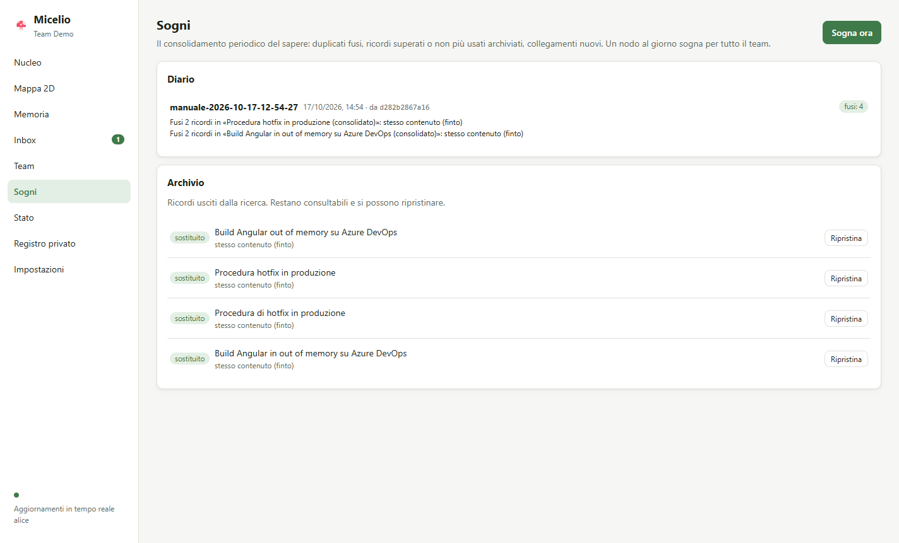

# Guida utente

Micelio è la memoria condivisa del team, pensata per gli assistenti AI. Ogni collega esegue un **nodo** sulla propria macchina. I nodi si sincronizzano tra loro via internet senza server centrale, e ognuno ha una copia completa del sapere del team.

> Versione attuale: **Fase 2**. Il sapere entra in due modi: salvataggi espliciti e raccolta automatica dalle sessioni di Claude Code nei progetti che abiliti tu. Prima di arrivare ai colleghi, ogni contenuto passa da un **filtro privacy**.

## 1. Installazione

Requisiti: **Node.js ≥ 22.13** (Windows, macOS o Linux). Per la raccolta automatica serve anche **Claude Code** installato e autenticato: Micelio usa il tuo abbonamento, nessuna API key.

```bash
git clone <repo> micelio && cd micelio
npm ci
npm run build
npm link            # installa il comando `micelio` nel PATH
```

## 2. Avviare il nodo

```bash
micelio start       # avvia il daemon in background
micelio status      # stato del nodo
micelio stop        # ferma il daemon
```

Il daemon deve restare attivo perché il nodo sincronizzi, perché gli assistenti AI possano usarlo e perché le sessioni vengano raccolte. Per ora va avviato a mano dopo ogni riavvio del PC; l'avvio automatico arriverà con l'app desktop (Fase 3).

I dati del nodo stanno in `~/.micelio`:

| File / cartella | Contenuto |
|---|---|
| `config.json` | Porta, **token** dell'API locale, impostazioni LLM, cartelle abilitate |
| `state.json` | Chiavi del team. **Contiene la chiave di cifratura: trattalo come una password** |
| `corestore/` | Log replicati del team |
| `view.db` | Indice di ricerca (derivato: si può cancellare, viene ricostruito) |
| `private.db` | **Archivio privato**: inbox, registro delle decisioni, coda, budget. Non lascia mai la macchina |
| `export/` | Copia Markdown in sola lettura del sapere del team |
| `logs/daemon.log`, `logs/hook.log` | Log del daemon e degli errori dell'hook di Claude Code |

Con `--home <cartella>` o la variabile `MICELIO_HOME` si possono tenere più nodi sulla stessa macchina (utile per i test).

## 3. Creare un team (solo la prima volta, una persona)

```bash
micelio init "Team Dev" --name pc-mario
```

Chi crea il team ne è **admin**. Gli admin possono espellere membri, nominare altri admin e cambiare le impostazioni del team. Consiglio: **nomina 2–3 admin** tra chi ha il PC più spesso acceso. Gli admin fanno anche da "garanti" dell'ordine degli eventi (*indexer*).

```bash
micelio members promote pc-lucia
```

## 4. Invitare un collega

**Qualunque membro** può invitare:

```bash
micelio invite
```

Il comando stampa un **codice monouso** valido 24 ore. Mandalo al collega su un canale privato: è un segreto. Il collega esegue:

```bash
micelio start
micelio join <codice> --name pc-lucia
```

- L'ingresso viene accettato da **qualunque membro online**, non per forza da chi ha invitato.
- Se `invite` avvisa che *nessun altro membro online ha ancora ricevuto l'invito*, resta online finché il collega non è entrato.
- Il nuovo membro riceve subito tutto il sapere già accumulato.

`micelio invites` mostra gli inviti non ancora usati.

## 5. Il filtro privacy: cosa arriva al team

Ogni contenuto, sia salvato a mano sia raccolto da una sessione, segue lo stesso percorso:

```
contenuto ─▶ filtro locale ─┬─▶ argomento HR/personale ───────────────▶ PRIVATO (resta sul tuo PC)
                            └─▶ segreti oscurati ─▶ classificazione (Claude Haiku)
                                                     ├─▶ tecnico e pulito ─▶ TEAM
                                                     ├─▶ dubbio ───────────▶ INBOX (decidi tu)
                                                     ├─▶ personale ────────▶ PRIVATO
                                                     └─▶ banale ───────────▶ scartato
```

- **Filtro locale.** Gira sul tuo PC *prima* di qualunque chiamata a Claude. Riconosce parole come "valutazione di fine anno", "RAL", "stipendio", "licenziamento", "malattia". Se ne trova una, il contenuto resta privato e non viene inviato a nessun servizio.
- **Segreti oscurati.** Token, chiavi API, password, credenziali negli URL, IBAN, codici fiscali, email e telefoni vengono sostituiti da segnaposto (`[REDACTED:github-token]`) prima di proseguire.
- **Classificazione.** Claude Haiku decide se il contenuto è conoscenza tecnica riutilizzabile. Se non è sicuro, o se il contenuto è misto (tecnico + sensibile), va in **inbox**: nel dubbio non si pubblica.

Sui 22 casi del set di valutazione (`npm run eval:ingest`), tutti gli 8 casi sensibili sono rimasti fuori dal team, compreso un feedback HR scritto senza parole "sospette".

## 6. Salvare e cercare ricordi

```bash
micelio remember "Build Angular in out of memory su Azure DevOps" \
  --kind gotcha --tags angular,ci \
  --body "Impostare NODE_OPTIONS=--max-old-space-size=6144 nello step di build."

echo "contenuto lungo..." | micelio remember "Titolo"     # corpo da stdin

micelio recall angular memoria build
micelio get c297bc9dc2d1                                  # id anche abbreviato
```

`remember` risponde con uno di tre esiti:

| Esito | Significato |
|---|---|
| `✔ Pubblicato nel team` | Mostra il testo esatto pubblicato, già ripulito dai segreti |
| `⏸ In inbox` | Serve una tua decisione (vedi §8) |
| `🔒 Non pubblicato, trattenuto come privato` | Con il motivo |

Tipi di ricordo (`--kind`): `fact`, `howto`, `decision`, `gotcha`, `snippet`, `reference`.

**Cosa salvare:** conoscenza tecnica riutilizzabile, cioè soluzioni verificate, decisioni con il loro *perché*, gotcha e procedure. Tutto ciò che arriva al team arriva a **tutti** e **non si può cancellare** dalle loro macchine.

La cartella `~/.micelio/export/team/` contiene un file Markdown per ricordo, comodo da sfogliare (anche con Obsidian). È in sola lettura e viene rigenerata.

## 7. Raccolta automatica dalle sessioni di Claude Code

È **opt-in per progetto**: Micelio guarda solo le sessioni avviate nelle cartelle che abiliti.

```bash
micelio setup claude-code           # una volta: registra MCP e l'hook di fine sessione
micelio watch add C:\progetti\ordini # abilita un progetto (e le sue sottocartelle)
micelio watch                        # elenco delle cartelle abilitate
micelio watch remove C:\progetti\ordini
```

Quando chiudi una sessione di Claude Code in una cartella abilitata, l'hook avvisa il daemon. La sessione passa dal filtro privacy (§5) e, se è tecnica, Claude Sonnet ne **distilla** da 0 a 5 ricordi atomici, pubblicati nel team.
- **Fedeltà alla fonte:** la distillazione riporta solo ciò che è stato detto o dimostrato nella sessione, senza aggiunte.
- **Sessioni brevi:** quelle che non insegnano nulla non producono ricordi.
- **Sessioni riprese:** se riprendi una sessione, viene elaborata solo la parte nuova.

```bash
micelio ingest status     # LLM disponibile? budget di oggi, coda, inbox
micelio ingest run        # elabora subito il prossimo lavoro in coda
```

`micelio setup claude-code` modifica `~/.claude/settings.json` e ne salva prima una copia (`settings.json.micelio-backup`). Con `--no-hook` registra solo MCP, senza raccolta automatica.

### Budget e modelli

Ogni sessione elaborata costa 2 chiamate a Claude (classificazione + distillazione); ogni salvataggio esplicito 1. Il default è **300 chiamate al giorno per nodo**. Quando finiscono, il lavoro resta in coda per il giorno dopo e non si perde. Si cambia in `~/.micelio/config.json`:

```jsonc
"llm": {
  "adapter": "claude",        // "none" = niente LLM: i casi dubbi vanno tutti in inbox
  "classifyModel": "haiku",
  "distillModel": "sonnet",
  "dailyBudget": 300
}
```

(dopo una modifica: `micelio stop && micelio start`)

## 7-bis. Cartelle di documenti

Micelio può leggere anche i documenti del team: PDF, Word, Excel, PowerPoint, OpenDocument, RTF, Markdown, testo.

```bash
micelio docs add C:\documenti\architettura --shareable   # i colleghi potranno scaricare gli originali
micelio docs add C:\documenti\appunti                    # solo distillato: gli originali restano qui
micelio docs                                              # cartelle e conteggi (elaborati, in coda, bloccati…)
micelio docs remove C:\documenti\appunti
```

- **Elaborazione:** ogni documento nuovo o modificato passa dallo stesso filtro privacy delle sessioni ed è distillato in ricordi. Un documento invariato non viene mai rielaborato, nemmeno dopo un riavvio.
- **Cartelle protette:** i documenti in cartelle come `HR`, `contratti`, `buste paga`, `valutazioni`, `candidati` o `privato` **non vengono nemmeno aperti**: restano privati e il motivo compare in `micelio private`. Gli admin possono aggiungere altri percorsi con `micelio team config filter.blockedPaths '["**/clienti/acme/**"]'`.
- **Documenti molto lunghi:** vengono distillati a parti, fino a 6 parti da circa 12.000 caratteri ciascuna.
- **Limiti:** i file oltre 20 MB e quelli protetti da password vengono saltati.

Anche dall'app: **Impostazioni → Cartelle di documenti**.

### Scaricare il documento originale

Al team arriva solo il distillato. Se serve approfondire, dal ricordo si può chiedere l'**originale**:

```bash
micelio fetch 8ea1102f047d      # id del ricordo
```

- **Da dove arriva:** dal PC del collega che possiede il documento. Quel PC deve essere acceso, e la cartella deve essere stata aggiunta con `--shareable`.
- **Dove finisce:** in `~/.micelio/sources/` e resta lì 30 giorni. Le copie scaricate non vengono mai ripassate ad altri: se cambi idea su una cartella, nessuna copia continua a circolare.
- **Verifiche:** chi chiede deve essere un membro attivo del team, e il file ricevuto viene controllato con la sua impronta (hash). Un collega non può mandarti un contenuto diverso.

Dall'app c'è il pulsante **Scarica l'originale** nel dettaglio del ricordo. Da Claude Code: *"scarica il documento originale di questo ricordo"* (tool `fetch_source`).

## 7-ter. Priorità: quali ricordi contano di più

Ogni ricordo ha un'**attivazione** da 0 a 100%, che dice quanto è "vivo" per il team. Cresce con:
- **uso recente:** ogni ricordo restituito da una ricerca conta come uso; i conteggi di tutti i colleghi si sommano;
- **voti di utilità;**
- **collegamenti con altri ricordi.**

Decade lentamente se nessuno lo usa. Una decisione decade più lentamente di uno snippet. Un ricordo **fissato** resta sempre al 100%.

```bash
micelio vote c297bc9dc2d1 up      # utile        (down = fuorviante o obsoleto, clear = ritira il voto)
micelio pin c297bc9dc2d1          # fissa: non decade e il dreaming non lo archivierà
micelio unpin c297bc9dc2d1
```

La ricerca (`recall`, app, Claude) è **ibrida**:
- trova i ricordi sia per parole sia per significato. Per esempio *"la build va in memoria esaurita"* trova *"out of memory nella pipeline"*, anche fra lingue diverse;
- a parità di pertinenza mette prima quelli con attivazione più alta.

Il calcolo dei significati (embedding) avviene sul tuo PC, senza servizi esterni. Al primo uso scarica un modello di circa 130 MB in `~/.cache/micelio-models`, condiviso da tutti i nodi della macchina. Per disattivarlo: `"embeddings": { "adapter": "none" }` in `config.json`.

Nell'app: attivazione, usi, 👍 👎 e 📌 nel dettaglio di ogni ricordo. Nel Nucleo i ricordi più vivi sono le stelle più grandi e dorate.

## 7-quater. Dreaming: il sapere si riordina da solo

Una volta al giorno **un** nodo del team "sogna" per tutti. Di default dalle 13; se quel nodo è spento o non ha Claude, tocca al successivo 30 minuti dopo, e così via. Il sogno:

- **fonde** i ricordi quasi uguali, scritti magari da colleghi diversi, in uno solo;
- **archivia** quelli superati da ricordi più recenti (per esempio una decisione cambiata);
- **collega** quelli correlati: i legami del dreaming sono le sinapsi dorate nel Nucleo;
- lascia **decadere** quelli che nessuno usa più da mesi (attivazione sotto il 15%, più di 90 giorni);
- scrive un **diario** di cosa ha fatto.

Niente viene cancellato: fusi e archiviati restano nell'**archivio** e si ripristinano. I ricordi **fissati** non vengono mai toccati. Ogni sogno usa al massimo 30 chiamate a Claude.

```bash
micelio dream now          # sogna subito su questo nodo
micelio dream log          # diario dei sogni del team
micelio archive            # ricordi archiviati o sostituiti
micelio restore <id>       # ripristina
```

Nell'app: schermata **Sogni**, con diario, "Sogna ora" e archivio con "Ripristina". Per non far mai sognare il tuo PC: `"dream": { "enabled": false }` in `config.json`.



## 8. Inbox: i casi dubbi

L'inbox contiene **solo** ciò su cui il filtro non ha potuto decidere da solo. I contenuti puliti vanno al team senza chiederti nulla, quelli chiaramente personali restano privati. L'inbox è locale: nessun collega la vede.

```bash
micelio inbox                                         # elenco con motivo e scadenza
micelio inbox approve 3f2a9c1e                        # pubblica così com'è
micelio inbox approve 3f2a9c1e --title "…" --body "…" # pubblica correggendo (es. togliendo un dettaglio)
micelio inbox reject 3f2a9c1e                         # scarta
```

Gli elementi non decisi scadono dopo **14 giorni**. Anche da Claude Code puoi chiedere *"cosa c'è nella mia inbox di Micelio?"*: Claude usa i tool `inbox_review` e `inbox_decide`, sempre dopo una tua decisione esplicita.

## 9. Registro privato

```bash
micelio private
```

Mostra cosa **non** è andato al team e perché: bloccato dal filtro, privato, scartato, rifiutato da te, scaduto. È solo sul tuo PC.

## 10. Impostazioni del team (solo admin)

Si replicano a tutti i nodi:

```bash
micelio team config memory.language en                                  # lingua dei ricordi distillati (default it)
micelio team config filter.blockKeywords '["progetto riservato","NDA"]'  # parole che bloccano, oltre a quelle di default
```

## 11. Usarlo da Claude Code

Dopo `micelio setup claude-code`, in qualunque sessione:

- *"Cerca nella memoria del team se abbiamo già risolto l'out of memory della build."*
- *"Salva nella memoria del team questa decisione: …"*

Claude ti mostra sempre il testo salvato a tuo nome, oppure ti dice che è finito in inbox o nel privato. Per far consultare la memoria in automatico, aggiungi al `CLAUDE.md` dei progetti una riga come:

```
Prima di task non banali cerca nella memoria del team con il tool micelio recall.
```

Dettagli sui tool e sugli altri client: [mcp.md](mcp.md).

## 12. Membri ed espulsioni

```bash
micelio members                 # albero degli inviti: chi ha invitato chi
micelio members remove pc-x     # solo admin
```

### Redazione (solo admin)

Se un dato sensibile è arrivato al team per errore:

```bash
micelio redact <id> --reason "conteneva un dato di un cliente"
```

Titolo e contenuto spariscono dalla vista di tutti i nodi e il ricordo non si può ripristinare.

**Limite:** chi l'aveva già letto, esportato o scaricato ne conserva una copia, e i blocchi cifrati restano nei log replicati. Per questo la difesa principale resta il filtro in ingresso.

### Metriche

`micelio metrics` (o `GET /api/metrics`) restituisce in JSON:
- uptime e memoria del processo;
- peer, membri, ricordi e archiviati;
- inbox, coda e documenti;
- chiamate LLM di oggi e numero di sogni.

Utile per la diagnostica o per un monitoraggio esterno.

### Espulsioni

Un membro espulso non può più scrivere nel team. **Limite intrinseco:** ciò che aveva già ricevuto resta sulla sua macchina. La rotazione della chiave per proteggere il sapere futuro è prevista in Fase 7.

## 13. Risoluzione problemi

| Sintomo | Causa probabile |
|---|---|
| `Il daemon Micelio non risponde` | Il daemon non è avviato: `micelio start`. Se non parte, guarda `~/.micelio/logs/daemon.log` |
| `join` va in timeout | Nessun membro del team è online, oppure l'invito non è ancora arrivato a nessun membro online. Riprova quando qualcuno è acceso |
| `Peer: 0 connessi` a lungo | Nessun altro membro online, oppure la rete blocca UDP. Il nodo riprova da solo ogni pochi secondi |
| Le sessioni di Claude Code non vengono raccolte | La cartella è abilitata (`micelio watch`)? Il daemon è attivo? Errori dell'hook in `~/.micelio/logs/hook.log`; sessioni ignorate segnalate in `daemon.log` |
| `ingest status` dice LLM "NON disponibile" | Claude Code non è nel PATH o non è autenticato. Imposta `llm.command` in `config.json` con il percorso completo di `claude` |
| Tutto finisce in inbox | Budget esaurito o LLM non disponibile (nel dubbio non si pubblica): controlla `micelio ingest status` |
| Porta 7337 occupata | Imposta `"port"` in `~/.micelio/config.json`, poi riesegui `micelio setup claude-code` |
| Claude Code non vede i tool | Il daemon deve essere attivo. Verifica con `claude mcp list` |
